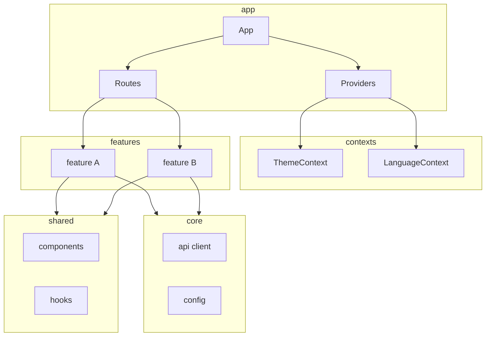

# Architecture

This project uses a **feature-based** layout to keep domains isolated and make future changes and new features easier to add.

## Layers

- **app** – Application shell: routing, root layout, and composition of global providers (theme, language, router).
- **core** – Infrastructure used by the whole app: API client, environment config, global types. No UI.
- **shared** – Code reused across features: generic UI components, hooks, utils, constants. No feature-specific logic.
- **features** – One folder per domain (e.g. auth, dashboard). Each feature contains its own components, hooks, API calls, and types.

## Dependency rules

- **Features must not import from other features.** Shared logic goes in `shared` or `core`.
- **shared** can use `core` (e.g. API client, config). **features** can use both `shared` and `core`.
- **app** wires providers and routes and can use `shared` and `core`; it may import from features only for route definitions (e.g. lazy-loaded pages).

This keeps dependencies one-way and avoids circular dependencies and tight coupling between domains.

## Data flow

- **API:** The `core/api` client is the single place for HTTP configuration (base URL, headers, error handling). Each feature can define its own API functions that use this client.
- **Global UI state:** Theme and language are handled by React Context providers in `contexts/`. Cross-feature app state can use Zustand (see [05-state-and-data.md](05-state-and-data.md)).
- **Feature state:** Local to a feature: component state, hooks, or feature-specific stores. Forms use react-hook-form within features.

